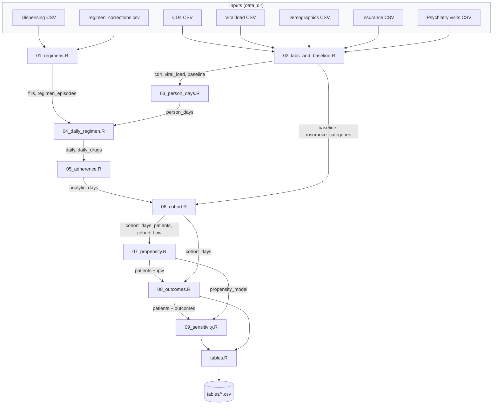

# Architecture

How the R translation is built: the scripts, the order they run in, and the objects they pass. What the analysis is meant to do is in `analysis-plan.md`; how to work here is in `AGENTS.md`.

Revision: November 2026, covering `R/` and `quarto/` at the first commit.

## Running it

```text
Rscript R/synthetic/make_synthetic_data.R   # fake input files in data-synthetic/
Rscript R/main.R                            # the translation, about 30 seconds on 400 synthetic patients
```

`R/main.R` sources every script into one R session; each script uses objects created by earlier ones. Nothing is saved between scripts except the final tables.

## Data flow



## Scripts

| Script | Stata it translates | Needs | Produces |
|---|---|---|---|
| `setup.R` | `global`s and hard-coded values | — | packages, `data_dir`, `source_files`, drug lists, thresholds, category limits |
| `functions.R` | rules written inline in Stata | `setup.R` | helper functions |
| `01_regimens.R` | Step 0B (+ 1A name fixes) | dispensing CSV, corrections file | `fills` (one row per drug dispensed), `regimen_episodes` (one row per regimen started), `regimen_drug_check` |
| `02_labs_and_baseline.R` | Steps 2, 3, 4, 4B, 4C | lab, demographic, insurance, psychiatry CSVs | `cd4`, `viral_load` (one row per test), `baseline` (one row per patient), `insurance_categories` |
| `03_person_days.R` | Step 5 | `baseline`, `cd4`, `viral_load` | `person_days` (patient × day, 2008-2013, with lab values carried forward and back) |
| `04_daily_regimen.R` | Steps 6, 7 | `person_days`, `fills`, `regimen_episodes` | `daily` (patient × day, current regimen), `daily_drugs` (patient × day × drug, pills dispensed) |
| `05_adherence.R` | Step 8 | `daily`, `daily_drugs` | `daily_drugs` with `pills_on_hand`; `analytic_days` (patient × day: coverage, still in care, suppressed) |
| `06_cohort.R` | Final Analysis, cohort | `analytic_days`, `baseline`, `insurance_categories` | `cohort_days` (patient × day from ART start), `patients` (one row per patient), `cohort_flow` |
| `07_propensity.R` | Final Analysis, baseline and propensity | `patients` | `baseline_tests`, `propensity_model`, `patients` + `propensity_score`, `ipw`; `weighted_balance` |
| `08_outcomes.R` | Final Analysis, outcomes | `cohort_days`, `patients` | `patients` + outcomes; `outcome_summary`, `outcome_models`, `suppression_at_switch` |
| `09_sensitivity.R` | Final Analysis, sensitivity | `cohort_days`, `patients`, `propensity_model` | `suppression_by_start_year`, `str_by_start_year`, `psych_models`, `outside_pharmacy_summary`, `outside_pharmacy_models` |
| `tables.R` | (the Stata wrote results to logs) | the tables above | CSV files in `tables/` |

`R/synthetic/make_synthetic_data.R` is a utility outside the workflow: it writes six CSVs and an example corrections file with the original column names, filled with random values.

## Design choices in the translation

- **Long, not wide.** Stata reshaped labs and fills to one row per patient with numbered columns, then looped over the numbers. R keeps one row per test, fill or drug and uses joins and grouped summaries.
- **One row per drug per day** replaces Stata's `CurrentDrug1...6` columns, so coverage is `all()`/`any()` over a group.
- **A patient table** (`patients`) replaces Stata's `if FirstObservationOfSubject` on every command.
- **Loops only where each value depends on the previous one:** pills on hand (`count_pills_on_hand()`), and processing regimens in order for the carry-over between them.
- **Manual corrections are data**, read from a file, not code.

## Website

```text
_quarto.yml, index.qmd, 404.qmd, styles.css
quarto/
  background.qmd, methodological_background.qmd, study_methods.qmd
  setup.qmd, functions.qmd, 01_regimens.qmd ... 09_sensitivity.qmd, tables.qmd   # one per script
  stata_overview.qmd, stata_data_build.qmd, stata_final_analysis.qmd
  _show_stata.R          # prints do-files as code blocks for the Stata pages
  analysis-plan.qmd, architecture.qmd, agents.qmd, repository-blueprint.qmd, about.qmd
stata/                   # the do-files behind the paper, patient-level details removed
docs/                    # rendered site (not committed)
.github/workflows/publish.yml   # renders the site and publishes it to gh-pages
```
